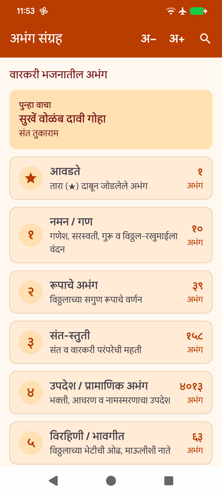
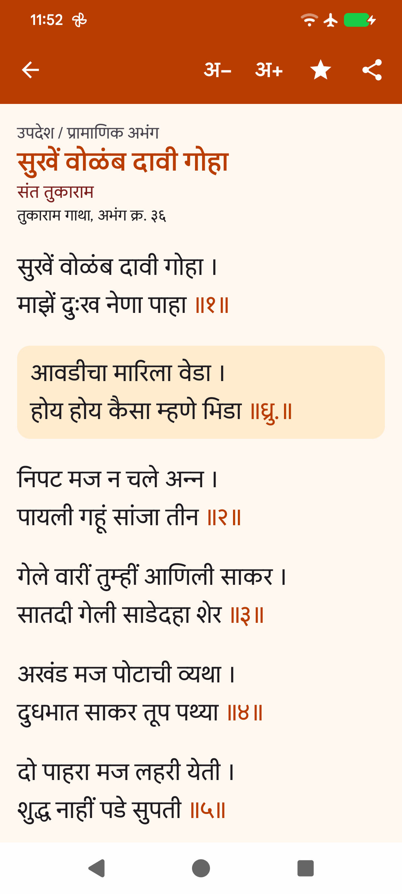
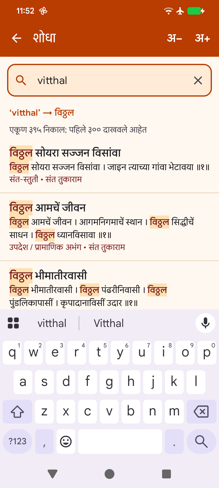

# अभंग संग्रह · Abhang

**वारकरी भजनातील अभंग — पूर्णपणे ऑफलाइन.**

Abhang is a free Android app for reading Marathi abhangs, the devotional verses of the Warkari tradition. It holds the Tukaram gatha, Namdev's abhangs, Dnyaneshwar's Haripath and Pasaydan, aartis and gajar chants. Everything is on your phone, so it works without the internet: at home, at a bhajan, or on the wari.

  
  
  

## Download

**[Download the latest APK](https://github.com/abhi-sawant/abhang/releases/latest)** from the Releases page. Each release lists what changed.

The app needs Android 7.0 or newer.

1. On your phone, open the Releases page and tap `abhang-<version>.apk` to download it.
2. Open the downloaded file. If Android asks, allow your browser or file manager to install unknown apps.
3. Tap **Install**.

To update, install the newer APK over the old one. Your favourites and settings stay.

## What's inside

4,476 texts in 9 categories, from नमन / गण to समाप्ती:

| Source | About |
| --- | --- |
| संत तुकाराम — तुकाराम गाथा | 4,339 abhangs |
| संत नामदेव — अभंगगाथा | 101 abhangs |
| संत ज्ञानेश्वर — हरिपाठ, पसायदान | 28 Haripath abhangs and the Pasaydan |
| आरत्या व गजर | Vitthal and Ganpati aartis, and gajar chants |

## Features

- **Fully offline.** The app has no internet permission. Nothing is collected or sent anywhere.
- **Search the way you type.** Write in Devanagari or in English letters: `vitthal`, `vithal` and `विठ्ठल` all find विठ्ठल. You can also search by abhang number.
- **Voice search.** Speak in Marathi using your phone's speech recognizer. It needs internet unless an offline Marathi voice pack is installed.
- **Comfortable reading.** Make the text larger or smaller with अ− / अ+. The screen stays on while you read, and the app follows your phone's light or dark theme.
- **Favourites and continue reading.** Star (★) the abhangs you sing often, and pick up the last one you read from the home screen.
- **Share** an abhang's text with its number.

## About the text

The text comes from public sources, mainly [Marathi Wikisource](https://mr.wikisource.org). The app labels each abhang so you know how far to trust it:

- **तपासले** — reviewed by a person.
- **स्वयंचलित दुरुस्ती; तपासणी आवश्यक** — the source text was damaged and repaired automatically. It may have small spelling mistakes. Many Tukaram abhangs still carry this label while review continues.
- **पाठ तपासणे आवश्यक** — the Haripath, Pasaydan and aartis differ between traditions. Check them against your own before singing.

If you find a mistake in an abhang, please [open an issue](https://github.com/abhi-sawant/abhang/issues) with its number and the correct text.

## Credits

- Tukaram gatha, Namdev abhangagatha and Pasaydan: [Marathi Wikisource](https://mr.wikisource.org), CC BY-SA.
- Haripath: mahitidarshak.com. Vitthal aarti: shubhpanchang.com. Ganpati aarti: amit.chakradeo.net.
- Font: Google Sans, SIL Open Font License.

The abhangs are traditional compositions of the sants and are in the public domain.

## For developers

The app is written in Kotlin with Jetpack Compose. The bundled text is generated by a Node script that reads Marathi Wikisource. [CLAUDE.md](CLAUDE.md) explains how to build the app, how the content pipeline works, and how releases are made.
